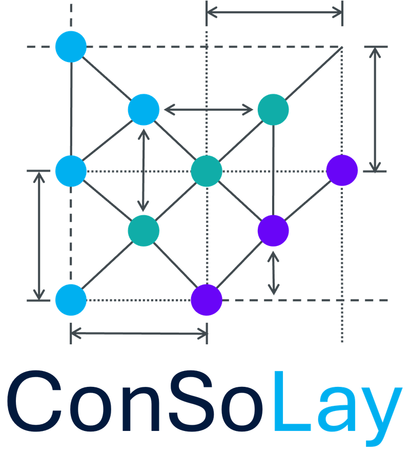

<p align="center">
  <picture>
    <source media="(prefers-color-scheme: dark)" srcset="supplement/logo-dark.png">
    
  </picture>
</p>

<p align="center"><b>Constraint-based layout, an add-on for VANTED</b></p>

Constraint-based graph layout in [VANTED](https://www.cls.uni-konstanz.de/software/vanted/) with the Adaptagrams
libraries (libcola, libvpsc, libavoid): the user states relations between nodes (25 constraint types: alignments, gaps,
orders, groups, areas, pins, rows, stars, ...), the add-on decides contradicting constraints by priority, projects the
drawing onto the applied constraints and shows every constraint with its state. Constraints come from three levels and
pass through the same loop:

- **by hand**: the Constraints page (tab "Constraint-Based Layout") with a palette, a list and a Conflicts section that
  explains every decision;
- **from a library**: templates (patterns with conditions on node and edge attributes and the constraints to create),
  composites and rule sets, found in a graph by a subgraph search and applied in batches (the Templates page);
- **by algorithm**: layout algorithms written as steps that add constraints instead of setting positions, with the
  SBGN PD, ER and AF layouts as the first ones (Algorithms › SBGN); other add-ons register their own through
  `layout.steps.StepLayoutRegistry` (see `supplement/algorithm-interface.md`).

## Build

Requirements: Java 8 (the add-on is compiled for Java 8 and runs inside VANTED's JVM), Apache Ant, a VANTED source
checkout with its third-party libraries next to this folder or under `~/VANTED`:

```
~/VANTED/vanted             VANTED, built once with `ant` (target/classes)
~/VANTED/vanted-libraries   VANTED's third-party jars, among them adaptagrams.jar with the natives
```

```bash
ant                       # builds target/jar/ConSoLay.jar (the add-on with the Adaptagrams binding inside)
ant test                  # the unit tests (two of them load the Adaptagrams natives)
ant -Dregression.java=$JAVA8_HOME/bin/java regression   # lays out every map in Files/ and compares with the baseline
```

Other locations: `-Dvanted.dir=/path/to/vanted -Dvanted.libs=/path/to/vanted-libraries`. `libs/sbgn-ed.jar` (the SBGN-ED
add-on, which reads and writes SBGN-ML) is on the class path; the SBGN layouts work on maps SBGN-ED has opened.

## Install

In VANTED: Edit › Preferences › Add-ons › Install Add-on, choose `target/jar/ConSoLay.jar` (or copy it into
VANTED's add-ons folder) and restart. The SBGN-ED add-on must be installed as well for SBGN maps. The tab
"Constraint-Based Layout" appears in the side panel; the Layout menu gets "Constraint SBGN Layout" and "Apply
constraints".

For development, `cblayout.StartVantedWithAddon` starts VANTED with the add-on from the class path (that is what the
IntelliJ run configuration does).

## Layout of the repository

| Path | What |
|---|---|
| `src/main/java/constraints` | the constraint model, the conflict decision (`ConstraintConflicts`), the check (`ConstraintCheck`), the SBGN guard (`ConstraintFeasibility`), the conflict log |
| `src/main/java/adaptagrams_bridge` | every call into libcola (`CBLayoutAlgorithm`, `UserConstraintTranslator`) |
| `src/main/java/layout/steps` | the interface for layout algorithms that add constraints (`StepLayout`, `StepAlgorithm`, `StepLayoutRegistry`, `StepTemplates`) |
| `src/main/java/layout/sbgn` | the SBGN PD, ER and AF layouts and their edge routing |
| `src/main/java/layout/template` | templates: model, JSON files, search, application |
| `src/main/java/layout/mental_map` | the mental-map layout with its snapshot timeline |
| `src/main/java/gui` | the tab (Algorithms page, Templates page, Constraints page, template editor), the overlay |
| `src/main/java/cblayout` | the VANTED plug-in entry (`CBLayout`), the menu entries |
| `tools/regression` | the headless regression run and the drag bench (not part of the jar) |
| `supplement` | the supplement of the paper: regression, algorithm interface, dragging, all switches, the TRN example |
| `Files` | the example maps (SBGN-ML) the regression and the tests use |

Every tuning decision of the layouts is a `-Dcblayout.<name>` switch with the previous behaviour as its other value;
`supplement/switches.md` lists them.

The constraints of a map are saved with the map: GML and GraphML carry them as a graph attribute (with stable ids on
the nodes and edges), so a saved map brings its constraints back when it is opened. SBGN-ML, whose writer keeps no
foreign attributes, gets a companion file `<map>.cbl.json` next to the map ("Save constraints…" on the Constraints
page); it is read with the map. Loading adds and decides the constraints and moves no node.

## Licence

GPL-2.0, like VANTED and the add-ons it builds on (see `LICENSE`). The transcription-network example in
`supplement/example_trn/` is derived from RegulonDB 10.7 (Santos-Zavaleta et al., NAR 2019), whose raw data is not
redistributed.
